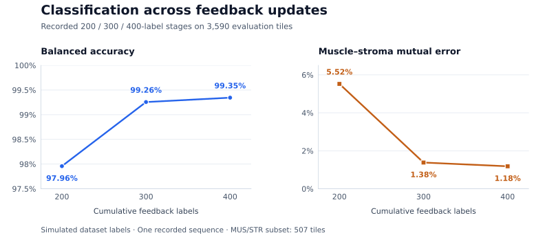

# HardPair

HardPair connects nine-class pathology classification with regional evidence
and targeted label feedback. This repository contains the team's Track B
implementation, review application, and recorded evaluation results.

## Approach

The workflow combines three components:

- Classification: a linear probe combines CONCH and MUSK image representations
  to predict tissue classes.
- Regional evidence: image regions associated with the predicted class and its
  closest alternative guide explanations from a LoRA-adapted Qwen2-VL-2B.
- Targeted feedback: encoder disagreement, prediction margins, and feature
  diversity select examples for additional labels, with extra coverage for
  muscle–stroma confusion.

Feedback refits the classifier on its training set and accumulated pool labels.
The final experiment keeps the Qwen explanation checkpoint fixed and retrieves
regional evidence for each updated prediction and alternative class.

## Results

On 3,590 evaluation tiles, increasing simulated feedback from 200 to 400 labels
raised balanced accuracy from 97.96% to 99.35%. Muscle–stroma mutual error fell
from 5.52% to 1.18%.

One recorded sequence with simulated dataset labels and a fixed evaluation
split. Each stage refits the classifier; the Qwen explanation checkpoint is
reused. Mutual error uses the 507 muscle or stroma tiles.
[Plot source and regeneration script](trackb/scripts/plot_feedback_results.py)
(requires Matplotlib).

The final classifier made **17 errors among 3,590 evaluation tiles**. It used
16,200 training tiles plus the selected feedback labels. Feedback and evaluation
came from separate splits of the CRC-VAL-HE-7K domain. Regional explanations
passed the recorded format and grounding checks for 1,959 tiles (54.6%); these
checks measure agreement with retrieved evidence, rather than expert-annotated
region accuracy.

## Review workflow

The Streamlit application brings predictions, regional evidence, and feedback
queries into one interface. Reviewers can inspect a prediction alongside its
alternative class and trace how selected labels enter the next classifier
update.

## Documentation

- [Application and implementation guide](trackb/README.md)
- [Evaluation and feedback results](trackb/docs/validation/gpu_final_2026-10-18/README.md)
- [Upstream project](https://github.com/alin4638/hardpair-trackb-handoff)
